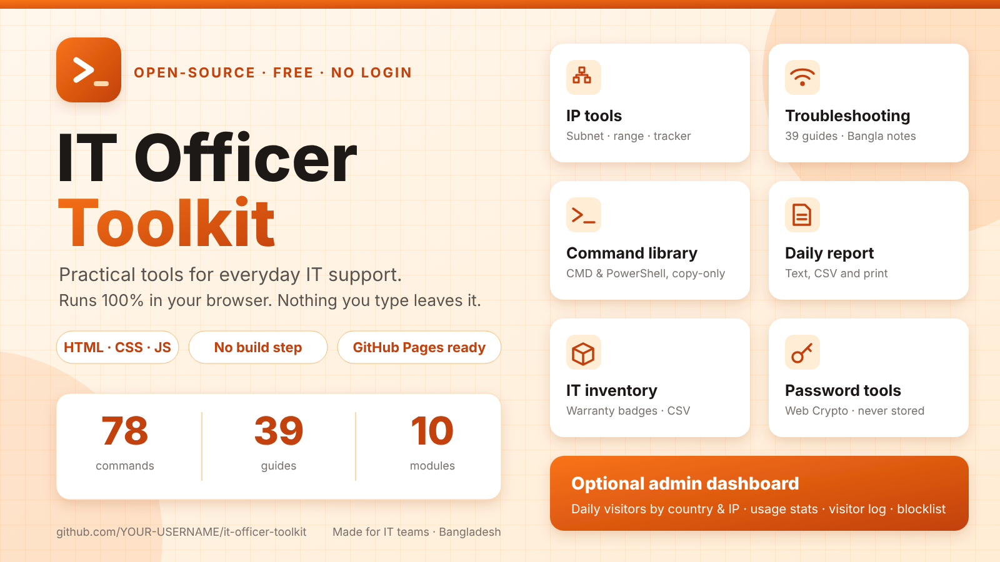
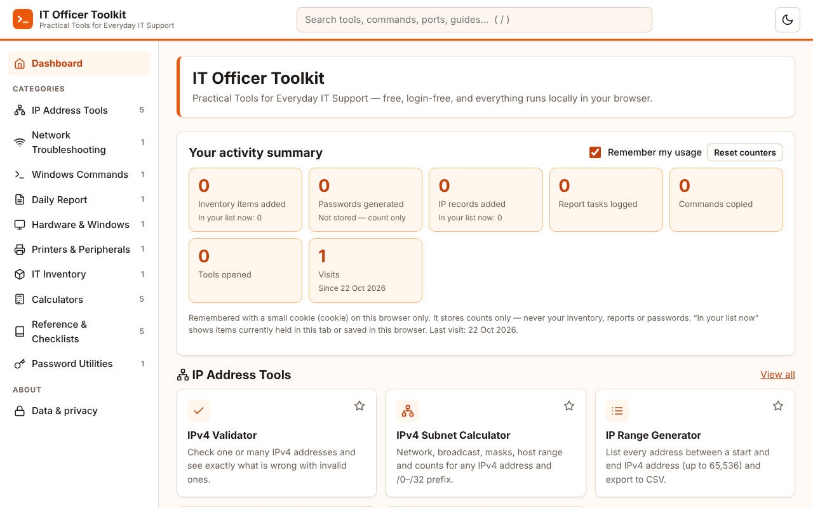
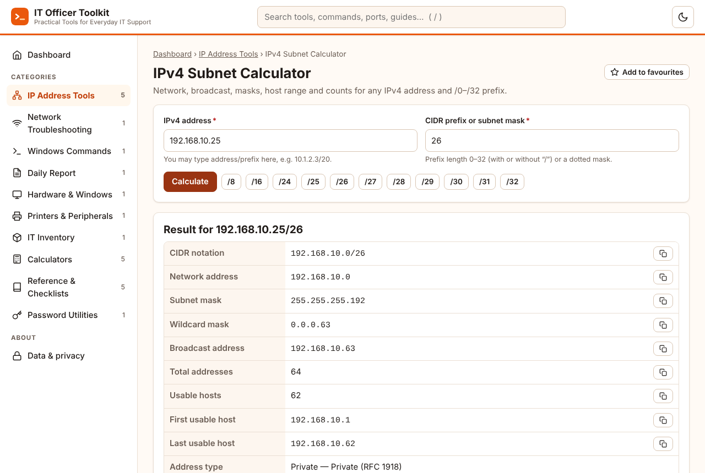
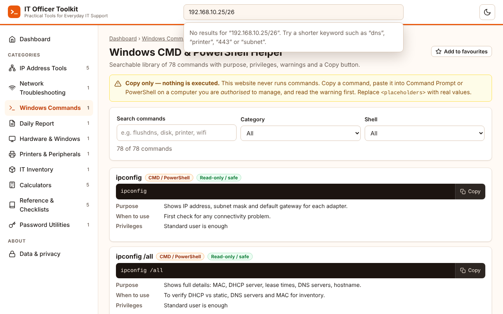
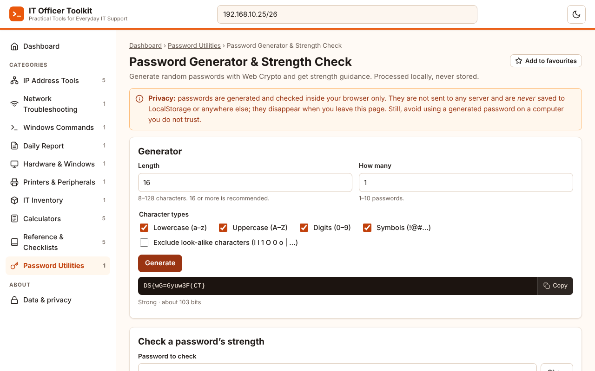
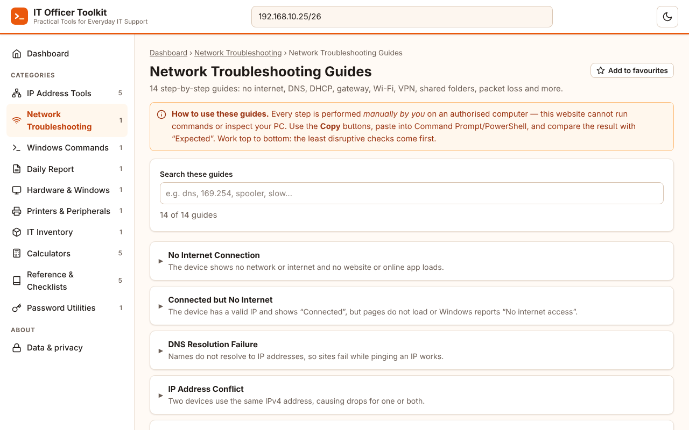

<div align="center">



# IT Officer Toolkit

**Practical tools for everyday IT support. Free, login-free, runs 100% in your browser.**


[**Live demo**](https://YOUR-USERNAME.github.io/it-officer-toolkit/) · [Features](#-features) · [Screenshots](#-screenshots) · [Quick start](#-quick-start) · [Admin dashboard](#-optional-admin-dashboard) · [Privacy](#privacy--local-data)

</div>

---

## About

IT Officer Toolkit puts the small tasks of daily IT support in one place: checking a subnet, finding a free IP, looking up a Windows command, following a troubleshooting guide, writing the daily report. It is built for IT officers, executives, support engineers and network admins (with Bangladesh in mind, useful anywhere).

- Pure **HTML + CSS + vanilla JavaScript**. No backend, no build step, no API keys, no external requests.
- **Local-first:** nothing you type leaves your browser. Saving to the browser is opt-in.
- Works on **GitHub Pages** as-is, and also by double-clicking `index.html`.
- Accessible (keyboard, labels, focus states), responsive, with light and dark themes.

## ✨ Features

| Module | What you get |
|---|---|
| **A. IP tools** | IPv4 validator (bulk) · Subnet calculator (/0–/32, /31 and /32 handled, mask or CIDR) · Range generator (up to 65,536, CSV) · IP availability tracker (statuses, search, edit, bulk add, CSV import/export, free-IP finder) · IP and MAC utilities |
| **B. Network guides** | 14 guides (no internet, DNS, DHCP, gateway, Wi-Fi, VPN, shared folder, printer, packet loss…) with symptoms, causes, ordered steps, copyable commands, expected results, escalation and Bangla summaries |
| **C. Command library** | 78 CMD/PowerShell commands with purpose, privileges, risk level and warnings. **Copy only; nothing is ever executed** |
| **D. Daily report** | Multiple entries, auto duration and totals, copy as text, print/PDF, CSV, optional local draft |
| **E. Hardware & Windows** | 16 guides plus battery-health and disk-free calculators |
| **F. Printers & peripherals** | 9 guides: offline, queue, driver, scanner, projector, keyboard/mouse, USB, audio |
| **G. Inventory** | Computers, printers, network gear, servers, CCTV/NVR with search, sort, filter, CSV and warranty status |
| **H. Calculators & reference** | Storage and speed converters, download time, uptime/SLA, UPS runtime, ports, DNS records, HTTP codes, Windows errors, 4 checklists |
| **I. Password tools** | Web Crypto generator (unbiased), look-alike exclusion, strength guidance. **Never stored** |
| **J. Usability** | Global search (`/`), favourites, recents, activity summary dashboard, white/orange theme with dark mode, copy feedback, confirmations |

## 🖼 Screenshots

| Dashboard | Subnet calculator |
|---|---|
|  |  |
| **Command library** | **Password tools** |
|  |  |

<details><summary>Dark theme</summary>


</details>

## 🚀 Quick start

```bash
git clone https://github.com/Hasifkhan/it-officer-toolkit.git
cd it-officer-toolkit
python3 -m http.server 8000      # then open http://localhost:8000
```
Or simply open `index.html` in your browser.

**Deploy free:** push to GitHub → *Settings → Pages → Deploy from branch → `main` / root*. Full steps below.

## 🛡 Optional admin dashboard

Off by default; the site stays fully static. Because GitHub Pages cannot see visitors' IP address or country, the admin area needs the small free Cloudflare Worker in [`analytics/`](analytics/README.md).

Once enabled, open `#/admin` and sign in with your admin token to see:
- Daily unique visitors, 7/30-day totals, active-now, new vs returning
- Visitors by **country** and **IP address**, most-used tools, devices and browsers
- Filterable visitor log with CSV export
- IP blocklist, per-IP data deletion, announcement banner, retention and purge controls

Visitors see a notice and can opt out; Do Not Track is honoured; IPs can be stored masked or hashed. IP addresses are personal data in many countries, so read the privacy notes in `analytics/README.md`. When enabled, the footer and privacy page update automatically.

---

## Run locally

Option 1 — just double-click `index.html` (works from `file://`; all scripts are plain, non-module scripts).

Option 2 — a local server (closer to production):

```bash
cd it-officer-toolkit
python3 -m http.server 8000
# open http://localhost:8000
```

## Publish on GitHub Pages

1. Create a repository (e.g. `it-officer-toolkit`) on GitHub.
2. Upload **the contents of this folder** so `index.html` sits at the repository root (drag & drop in the web UI, or `git init && git add . && git commit -m "Initial commit" && git remote add origin <url> && git push -u origin main`).
3. Repository → **Settings → Pages** → *Build and deployment* → Source: **Deploy from a branch** → Branch: `main`, folder `/ (root)` → Save.
4. After a minute the site is at `https://<username>.github.io/<repository>/`.
5. Replace `YOUR-USERNAME` in the footer link in `index.html` with your GitHub username.

All asset paths are relative and routing uses `#/…` hash URLs, so the app works at a sub-path like `/it-officer-toolkit/`.

### Deployment troubleshooting

- **404 page** – `index.html` must be in the root of the published branch/folder; wait 1–2 minutes after enabling Pages.
- **Unstyled page / nothing happens** – open DevTools → Network; a 404 on `assets/...` means folders were uploaded with the wrong case or an extra parent folder. Paths are case-sensitive on GitHub.
- **Old version after update** – hard refresh (Ctrl+F5).
- **Copy buttons do nothing** – clipboard needs HTTPS or localhost (GitHub Pages is HTTPS). A manual-copy dialog appears if the browser blocks it.

## Privacy & local data

- No server, no account, no external API or CDN. Nothing you type leaves your browser.
- Lists (IP tracker, inventory) and the report live **in memory only** until you opt in to saving (LocalStorage). Report drafts are saved only when you press *Save draft*.
- Favourites, recent tools and theme are stored in LocalStorage.
- **Usage cookie:** a first-party cookie `itk_usage` (1 year, SameSite=Lax, scoped to the site folder) remembers *counts only* (inventory items added, passwords generated, IP records, report tasks, commands copied, tools opened, visits). It never contains inventory, report or password content. Toggle or reset it on the dashboard. Where cookies are unavailable (e.g. opening `index.html` from disk) the counters fall back to LocalStorage.
- LocalStorage is per-browser/per-device, not synced, not encrypted, can be wiped by the browser, and is **not a backup** — export CSV regularly. Do not enable saving on shared computers or enter confidential data/passwords.
- Passwords generated or checked are never stored.
- Clear everything from **Data & privacy** in the footer/sidebar.
- If storage is blocked or full, the app keeps working for the session and tells you.

## Tests

```bash
node tests/run.js                       # unit tests of IP maths, CSV, report, calculators, password, content integrity
# optional browser test (needs Playwright + Chromium); serve from a sub-folder URL to test relative paths:
NODE_PATH=<path-to>/node_modules node tests/ui-smoke.js http://localhost:8000/it-officer-toolkit/index.html
```

Backend and admin tests (Node 22+; use a SQLite stand-in for Cloudflare D1, so a real Cloudflare deployment is not covered):
```bash
node --no-warnings tests/worker.test.mjs
NODE_PATH=<path-to>/node_modules node --no-warnings tests/e2e-admin.mjs
```

## Project structure

```
index.html
assets/css/styles.css
assets/js/  storage.js (utils, storage, icons) · datatable.js (shared CRUD table) · ip-tools.js
            troubleshooting.js · command-library.js · report-generator.js · inventory.js
            calculators.js · password.js · app.js (router, search, theme)
assets/icons/favicon.svg
assets/js/  config.js · analytics.js · admin.js   (optional visitor analytics + admin)
analytics/   worker.js · schema.sql · wrangler.toml · README.md   (Cloudflare Worker backend)
docs/        poster.svg · poster.png · screenshots/
tests/
```

To add a guide or command, append an entry in `troubleshooting.js` / `command-library.js` — search, cards and the dashboard pick it up automatically.

## Known limitations

- It cannot scan networks, ping, or verify that an IP is free/online; “Free” means only what you recorded. It never runs commands.
- Public-IP lookup and MAC vendor (OUI) lookup are intentionally absent (they need external services/large data).
- IPv4 only. Range generation capped at 65,536 addresses; imports capped at 1 MB / 5,000 rows (inventory 3,000).
- Report durations are same-day only (split overnight work). Print/PDF uses the browser’s print dialog.
- Troubleshooting content is general guidance; verify against your environment and company policy. Bangla summaries are brief and were written without native-speaker review — please have a Bangla speaker proofread them.
- Strength meter is a heuristic, not proof of password safety.

## License

MIT. See [LICENSE](LICENSE). Replace the name in the file with yours.
